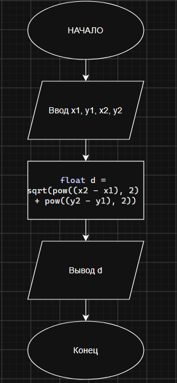

# Домашнее задание к работе 3

## Условие задачи
# Домашнее задание к работе 2

## Условие задачи
В течение месяца продавец доставлял на дом 4 л. молока в день. В марте молоко стоило **x** руб. за литр. С первого апреля цена молока увеличилась на **(x + a)** руб. за литр. Сколько надо заплатить продавцу за все доставленное молоко в конце апреля? Количество покупаемого молока осталось прежним.

## 1. Алгоритм и блок-схема

### Алгоритм
1. **Начало**
2. Объявление переменных:
  - 'x1' - координата по оси x для первой точки
  - 'y1' - координата по оси y для первой точки
  - 'x2' - координата по оси x для второй точки
  - 'y2' - координата по оси y для второй точки
3. Ввод данных для переменных из пункта 2
4. Расчет расстояния по формуле евклидова расстояния
  - 'd' = sqrt(pow(('x2' - 'x1'), 2) + pow(('y2' - 'y1'), 2))
5. Вывод результата
6. **Конец**
   

### Блок-схема
 

## 2. Реализация программы

'''
#define _CRT_SECURE_NO_WARNINGS
#include <stdio.h>
#include <locale.h>
#include <math.h>

int main() {
	setlocale(LC_CTYPE, "RUS");

	int x1, x2, y1, y2; //координаты

	printf("Введите координаты x1, y1 и x2, y2\n");
	scanf("%d %d %d %d", &x1, &y1, &x2, &y2);

	float d = sqrt(pow((x2 - x1), 2) + pow((y2 - y1), 2)); //расчет дистанции по формуле евклидова расстояния

	printf("Расстояние между точками: %f\n", d);

	return 0;
}
'''

## 3. Результаты работы программы

'''
Введите координаты x1, y1 и x2, y2
30 50
90 76
Расстояние между точками: 65.391129
'''

## 4. Информация о разработчике

Лупачев Сергей бТИИ-262
